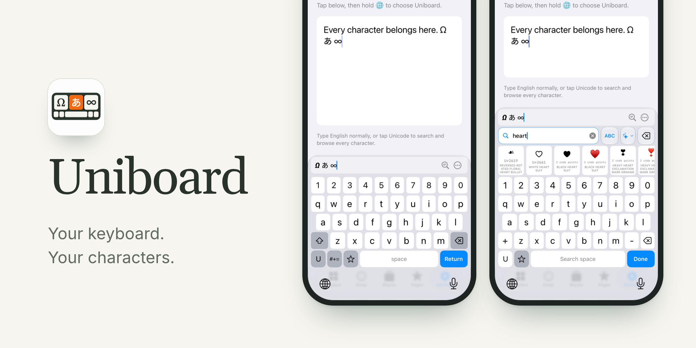
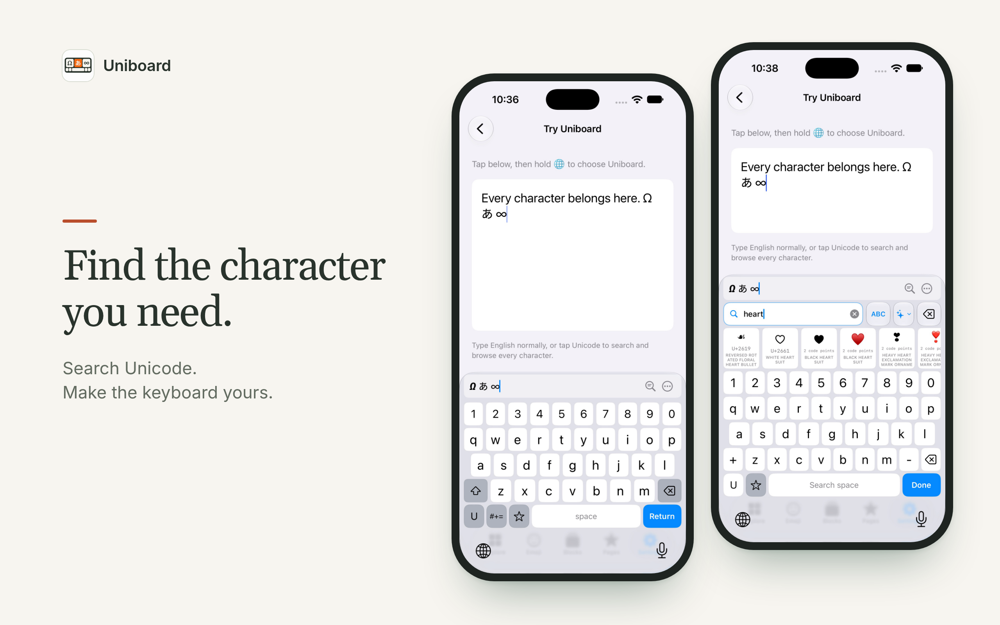
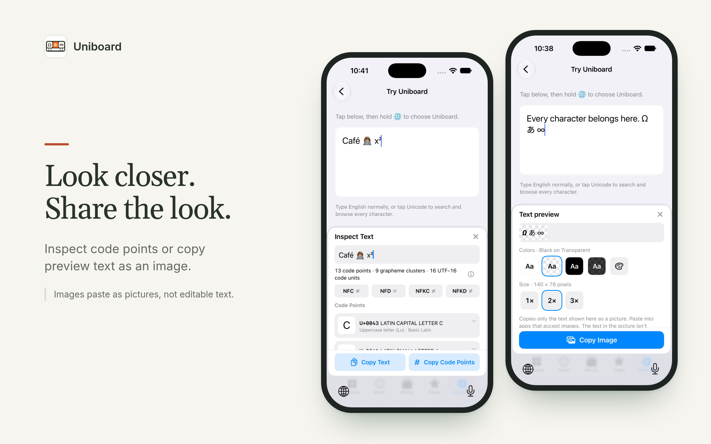
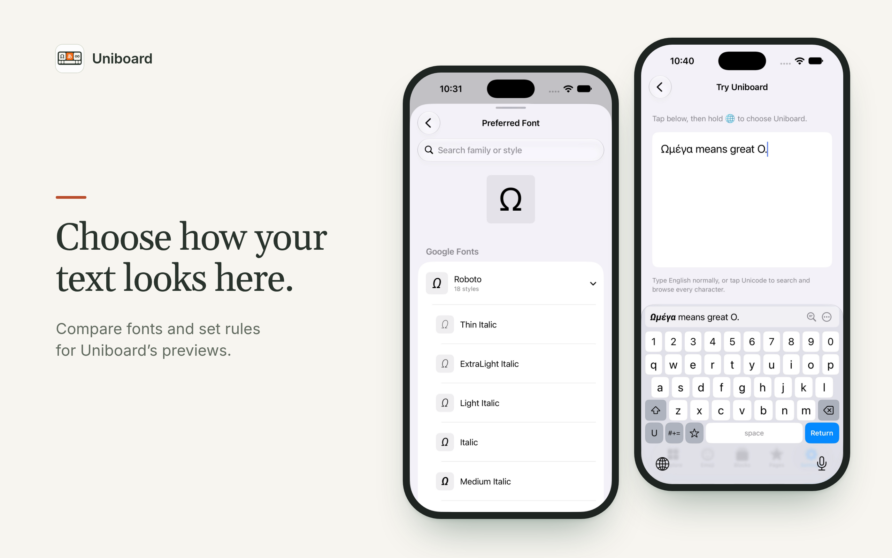

# Uniboard

<p align="center">
  
</p>

Uniboard is an iPhone and iPad app with a custom keyboard extension for browsing, searching and typing every Unicode character and emoji, offline. The app (`ad.neko.uniboard`) explores the Unicode catalog and configures the keyboard; the keyboard (`ad.neko.uniboard.keyboard`) types literally into any app that allows custom keyboards and adds Unicode search, symbol pages and favorites. There are no accounts, ads or analytics, and typing and searches are never sent to a server.

The App Store currently has version 1.1. The next release is **1.3** (`MARKETING_VERSION` in `project.yml`).

## Features (1.3)



- **Explore and search.** Explore every block or every assigned character as tiles or as a code chart, browse Blocks and Emoji, and see what each edition adds in What's New. Search by name, alias, annotation, block name, NamesList heading, code point (`U+1F680`, `0x1F680`, `1F680`, `decimal:128640`) or the character itself. Character details show the official name, properties, encodings, and the text and emoji forms where both exist.
- **Keyboard search.** The U key opens Unicode search inside the keyboard. Tapping a key edits the local query; holding a key types that character into the document without changing the query. A search index cached in the App Group speeds up searches and contains only catalog data, never typed text.
- **Layouts and keys.** English QWERTY plus 14 other Latin layouts, Greek, and Russian, Ukrainian, Bulgarian and Serbian Cyrillic (Settings → Layouts). Hold the space bar to switch layouts. Customize Keys gives each letter, number and symbol key its own swipe-up, swipe-down and hold choices. Pages → Keyboard edits and drags the main keyboard's keys, number row included.
- **Pages and Favorites.** Create, order and edit symbol pages in the Pages tab. Each page opens on a canvas drawn as the keyboard draws it, with rows, gaps and drag-and-drop. Pages can be exported to a file and imported again. Favorites are shared between the app and the keyboard's Favorites page.
- **Auto-capitalization.** Follow App, Off, Sentences, Words or All Characters (Settings → Auto-Capitalization).
- **Text Preview.** An optional row above the keys shows the text around the caret, drawn with Uniboard's preview fonts. Tapping or dragging in the preview moves the real cursor within the text the receiving app exposes.



- **Inspect Text.** A read-only panel for the visible preview text: code points with names and metadata, grapheme clusters, the NFC, NFD, NFKC and NFKD forms, and UTF-8 and UTF-16 hex. It never changes the document.
- **Copy Image.** Copies the visible preview text as a PNG at 1×, 2× or 3×, in black or white on a solid or transparent background, or in custom colors. It pastes as a picture, not as editable text.



- **Preview fonts.** Extra Unicode Fonts is off by default. Optional font packs download on demand. You can add your own TrueType or OpenType file, or use a font installed on the device. **Font Rules** choose a preferred font for a code point, range or Unicode block. **View Fonts** in a character's details compares every available face. A bundled **Google Fonts** catalog lists families by name, and its **styles grid** downloads single styles or files. Preview fonts affect only Uniboard's own rendering, never the receiving app.
- **ConScript (UCSUR).** An optional setting shows the ConScript Unicode Registry's names and blocks for Private Use characters.
- **Configuration file.** Export and import one TOML file containing settings, layouts and keys, favorites, font choices and rules, and Copy Image options. You can also edit the configuration as text in the app: Validate checks it without changing anything, and Apply shows the same review as an import. Before an import or an edit replaces anything you can review the changes, and Undo Last Configuration Change restores the previous state.

### Full Access

The keyboard declares `RequestsOpenAccess`, but Full Access is optional. These work **without** it: typing, Unicode search and insertion, pages, favorites added in the app, all app settings (editions, layouts, keys, fonts, font rules, capitalization), Text Preview with cursor movement, and viewing Inspect Text. The keyboard only reads the shared App Group files. These **need** Full Access:

- writing favorites saved in the keyboard back to the app
- light key haptics on supported iPhones
- copying from the keyboard: Copy Image and the Inspect Text copy buttons
- publishing Copy Image color and scale choices made in the keyboard to the app, which also puts them in configuration exports
- recording which fonts the keyboard can open, used by the app's font picker

The keyboard has no downloader and makes no network requests, with or without Full Access. iOS uses its own keyboard in secure and phone-number fields, and some apps don't allow custom keyboards.

## Requirements

- Xcode 26 or later. The Liquid Glass APIs need the iOS 26 SDK, and CI uses Xcode 26.3 on `macos-15` runners.
- Deployment target: iOS 17.0, for iPhone and iPad.
- Python 3 and Ruby for the scripts and their tests. `Scripts/requirements-fonts.txt` pins fontTools, which only the font build scripts need.
- Optional: [XcodeGen](https://github.com/yonaskolb/XcodeGen), only when you change `project.yml`.

## Build and run

1. Open `Uniboard.xcodeproj` and run the **Uniboard** scheme. The scheme builds the app and embeds the keyboard. The committed project builds without XcodeGen; after editing `project.yml`, run `xcodegen generate`.
2. Signing is automatic, with the Kitta Ltd team set in `project.yml`. To use another account, select your team for both the `Uniboard` and `UniboardKeyboard` targets. Both targets share the App Group `group.ad.neko.uniboard`, so another team also needs its own bundle IDs and App Group.
3. Enable the keyboard: **Settings → General → Keyboard → Keyboards → Add New Keyboard → Uniboard**. Then use **Settings → Try Your Keyboard** in the app, or any text field, and hold 🌐 to switch to Uniboard.

To build for the simulator without signing:

```sh
xcodebuild -project Uniboard.xcodeproj -scheme Uniboard \
  -destination 'generic/platform=iOS Simulator' CODE_SIGNING_ALLOWED=NO build
```

## Project layout

| Path | Contents |
| --- | --- |
| `App/` | SwiftUI containing app: Explore, Emoji, Blocks, Pages, Settings, font and configuration screens; bundled Google Fonts catalog in `App/Resources/GoogleFonts` |
| `Keyboard/` | Keyboard extension (`KeyboardViewController`, query field, symbol-board panel) |
| `Shared/` | Code and resources compiled into both targets. Most of it is also the `UniboardCore` Swift package (`Package.swift`); Unicode data is in `Shared/Resources` |
| `Fonts/` | Optional font manifests (`manifest.json`, `DownloadableFonts.json`) and license texts. No font binaries |
| `Tests/` | Unit tests, run by both `swift test` (`UniboardCoreTests`) and the native `UniboardTests` target |
| `UITests/` | XCUITest suites, one class per feature area |
| `Scripts/` | Unicode, UCSUR, font and Google Fonts generators, validators, coverage gate, App Store helper, and their tests in `Scripts/tests` |
| `ci_scripts/` | Xcode Cloud hooks |
| `docs/` | Format specs, quality notes, test runs, font notes, store copy |
| `website/` | Static public website (Cloudflare Pages) |
| `fastlane/`, `marketing/`, `AppStore/`, `TestFlight/` | Store listing copy, icon and screenshots, review notes, tester notes |
| `design/` | Design specifications for app and keyboard features |

## Testing

### Core package and script checks

The quality gate, run on every push and pull request to `master` by `.github/workflows/quality.yml`:

```sh
python3 -m unittest discover -s Scripts/tests
ruby Scripts/tests/test_app_store_release.rb
python3 Scripts/validate_fonts.py
swift test --enable-code-coverage
python3 Scripts/check_swift_coverage.py "$(swift test --show-codecov-path)"
```

`Scripts/check_swift_coverage.py` reads the llvm-cov JSON and requires 100% executable-line coverage for each core `Shared/` file it lists. A missing, duplicate or malformed coverage record fails the check. See [docs/quality.md](docs/quality.md) for the boundary matrix.

### Native unit tests

```sh
xcodebuild -project Uniboard.xcodeproj -scheme Uniboard \
  -destination 'platform=iOS Simulator,name=iPhone 17 Pro' \
  -only-testing:UniboardTests -enableCodeCoverage YES \
  CODE_SIGNING_ALLOWED=NO test
```

Use any available iPhone simulator. CI picks one with `Scripts/select_ios_test_destination.py`.

### UI tests

The UI tests are grouped by feature area; [docs/ui-test-shards.md](docs/ui-test-shards.md) maps source files to areas. Tests that drive the installed system keyboard skip unless `UNIBOARD_KEYBOARD_INTEGRATION=1`. The scheme passes this build setting through to the test runner, so set it on the `xcodebuild` command line. These tests add Uniboard through the simulator's Settings and switch to it with the globe key. Run them on a dedicated simulator with the software keyboard visible (turn off **Simulate Hardware Keyboard**).

App-to-keyboard checks need the App Group, so build with ad hoc simulator signing:

```sh
xcodebuild -project Uniboard.xcodeproj -scheme Uniboard \
  -destination 'platform=iOS Simulator,name=iPhone 17 Pro' \
  -parallel-testing-enabled NO \
  CODE_SIGN_STYLE=Manual CODE_SIGN_IDENTITY=- DEVELOPMENT_TEAM= PROVISIONING_PROFILE_SPECIFIER= \
  UNIBOARD_KEYBOARD_INTEGRATION=1 \
  -only-testing:UniboardUITests/SmokeUITests \
  -only-testing:UniboardUITests/AppBrowsingUITests/testBrowseUnicodeBlockAndOpenCharacter \
  -only-testing:UniboardUITests/AppBrowsingUITests/testSearchByCharacterNameAndLiteral \
  -only-testing:UniboardUITests/FontSettingsUITests/testOptionalFontDownloadCatalogIsOnlyInAppSettings \
  test
```

- **Default: smoke.** The command above checks that the app launches and browses, search works and Settings opens, and that the keyboard switches in, types English and inserts a search result and a page key.
- **Per change: the area classes.** Replace the `-only-testing` lines with the classes for the area you changed. Add the smoke run if the change is wide.

  | Area | Classes |
  | --- | --- |
  | Browsing | `AppBrowsingUITests` |
  | Fonts | `FontSettingsUITests` `FontRulesUITests` `FontExplorationUITests` `StyleGridUITests` |
  | Layouts | `KeyboardLayoutUITests` |
  | Pages | `PagesUITests` |
  | Typing | `KeyboardTypingUITests` |
  | Search | `KeyboardSearchUITests` |
  | Inspect | `KeyboardInspectUITests` `TextPreviewUITests` |
  | Preview and Copy Image | `TextPreviewUITests` |
  | Configuration | `ConfigurationUITests` |

- **Full run: GitHub only.** Start the manual **UI full** workflow (`.github/workflows/ui-full.yml`, `workflow_dispatch`) from the Actions tab. It runs the areas as parallel jobs and uploads one `.xcresult` per area.
- `KeyboardSearchBenchmarkUITests` measures search timing. It isn't part of any run; select it by name when you need numbers.

## Configuration file

The app's **Settings → Configuration** screen exports and imports a single TOML 1.0 file. Before anything is written, import validates the whole file and shows what will be replaced or reset. A missing section means factory defaults. Configuration files never contain font binaries, file paths, URLs or typing history. Only the app parses TOML; the keyboard reads JSON snapshots derived from the same configuration. The full schema and limits are in [docs/configuration-format.md](docs/configuration-format.md).

## Unicode data and editions

Choose the edition in the app's Settings, or from the version menu in Explore, Blocks and Emoji. The keyboard follows the app's choice.

- **Unicode 18.0.0**: latest release and the default
- **17.0.0** and **16.0.0**: the two previous releases
- **Unicode 19.0.0 draft**: only when chosen explicitly

Only the development draft's catalogs are bundled: characters, properties, blocks and fully qualified emoji, in `Shared/Resources`. Each final edition is the draft filtered by Unicode Age, and its emoji by Emoji version, so a character added later reads as unassigned in that edition. `Shared/Resources/UnicodeSources.json` records provenance: the pinned `unicode-org/unicodetools` commit, a SHA-256 for each source, the final-edition labels and `refreshedAt`. A transient download failure is retried; an invalid or exhausted fetch fails without replacing the existing catalog.

```sh
python3 Scripts/generate_unicode.py --source all --refresh
swift test
```

`Scripts/build_ucsur.py` builds `Shared/Resources/UCSUR.txt` from the ConScript registry's UNIDATA files.

**Monthly refresh.** `.github/workflows/unicode-monthly.yml` runs at 03:17 UTC (12:17 Japan time) on the first of each month, and can also be started manually. It validates the scripts and fonts, regenerates the catalogs, runs the core tests with the coverage gate and builds the app and keyboard for the simulator. If the data changed, it commits the catalogs and provenance to `master`. The default branch must be `master`.

## Fonts and licenses

No font is compiled into the app or keyboard. Settings → Font Downloads offers seven optional packs: Preview basics (Noto Sans Symbols 2, GNU Unifont and Unifont Upper, and a combining-mark face), historic scripts and symbols, two rare-Han packs, Seal script, emoji previews (Noto Color Emoji) and ConScript (Fairfax HD). Packs download only when you ask. They are fetched from pinned GitHub sources, checked against their size and SHA-256, never installed system-wide, and read by the keyboard from the App Group. Apart from font rules and fonts you add yourself, pack fonts are used only for previews iOS can't draw. Supported system glyphs and emoji stay unchanged, and characters still missing are tinted red. Settings → Font Licenses shows the full license texts. Details are in [docs/font-pack.md](docs/font-pack.md) and [docs/google-font-catalog.md](docs/google-font-catalog.md).

- Noto, Unifont, Fairfax HD, Cuneiform, NewGardiner, UniHieroglyphica and UFS Tangut fonts: SIL Open Font License 1.1. Jigmo: CC0. The texts are in `Fonts/`.
- **Seal Sans** is distributed unchanged as a separate download under the **GNU AGPL v3**. `Fonts/SealSans-AGPL.txt` gives the license and links to the corresponding source. It is not part of the app or keyboard binary.
- Google Fonts are downloaded one style at a time from the pinned `google/fonts` catalog, each under its own upstream license.
- `python3 Scripts/validate_fonts.py` checks the manifests, hashes, outlines, licenses and size budgets. It runs in CI, in the monthly refresh and before every Xcode Cloud build.

## Release

- **Version:** `MARKETING_VERSION` and `CURRENT_PROJECT_VERSION` in `project.yml`, applied to both targets.
- **Xcode Cloud** builds the committed `Uniboard.xcodeproj` and shared **Uniboard** scheme on pushes to `master`, archiving for TestFlight and the App Store. `ci_scripts/ci_post_clone.sh` checks prerequisites. `ci_scripts/ci_pre_xcodebuild.sh` validates the fonts, runs the script tests, regenerates all editions with `--refresh` and runs the core tests with the coverage gate. Any failure fails the build. Each monthly data commit therefore produces an archive with fresh data. Xcode Cloud needs no XcodeGen or third-party package managers.
- **Store material:** listing copy in `fastlane/metadata/{en-US,ja}`, drafted 1.3.0 copy in [docs/store-copy-1.3.0.md](docs/store-copy-1.3.0.md), tester notes in `TestFlight/WhatToTest.en-US.txt`, reviewer instructions in `AppStore/ReviewNotes.en-US.txt`, and icon and screenshots in `marketing/`. `Scripts/app_store_release.rb` makes only GET requests unless given explicit flags; see `Scripts/APP_STORE_RELEASE.md`.
- **Website:** the static site in `website/` is served by Cloudflare Pages at <https://uniboard-dxm.pages.dev/>, with support at `/support/`. The privacy policy is at <https://docs.kitta.co/uniboard/>, and `/privacy` redirects there. `.github/workflows/website.yml` validates changes on `master`. Deployment is manual, from a local Cloudflare login, so no account credentials are stored in GitHub:

  ```sh
  python3 Scripts/validate_website.py
  wrangler pages deploy website --project-name uniboard --branch master
  ```

  Deploy only `website/`, then check the public pages before updating App Store URLs.

## License

- Unicode data: Unicode License v3, `Shared/Resources/Unicode-LICENSE.txt`, also shown in the app under Settings → Data & License.
- Fonts: their own licenses in `Fonts/`, as listed above. The Roboto test fixture is under OFL 1.1, `Tests/Fixtures/Roboto/OFL.txt`.
- Uniboard's own source code: MIT License, see [`LICENSE`](LICENSE). Uniboard is developed by Kitta Ltd.
- The MIT License does not cover the third-party data and fonts above; they keep their own licenses.
